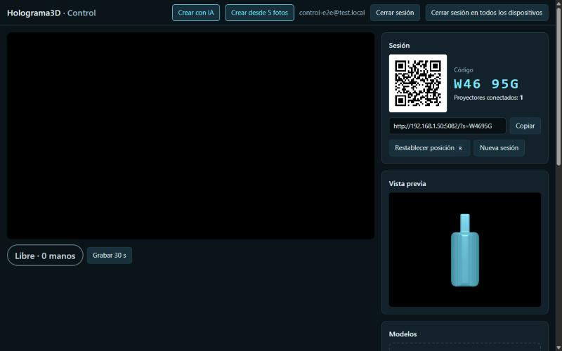
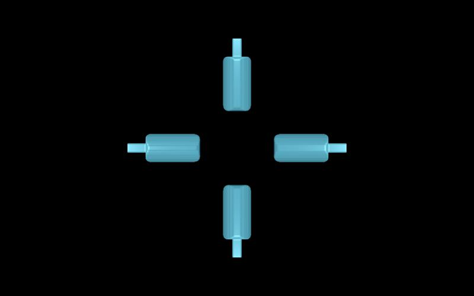
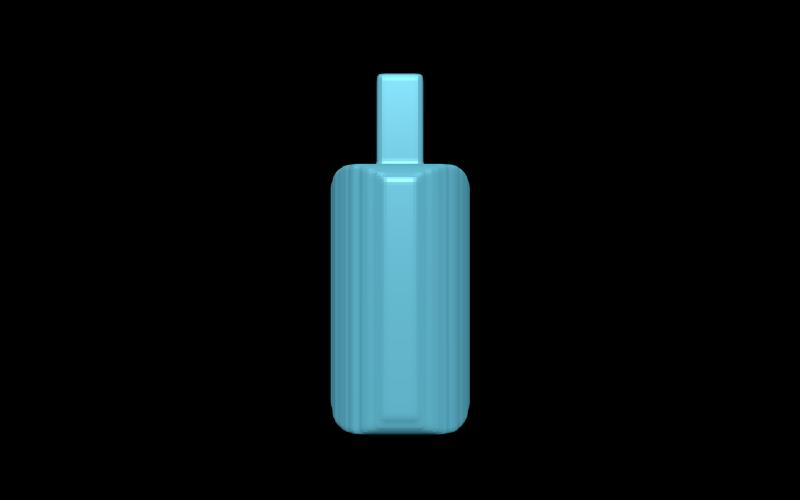
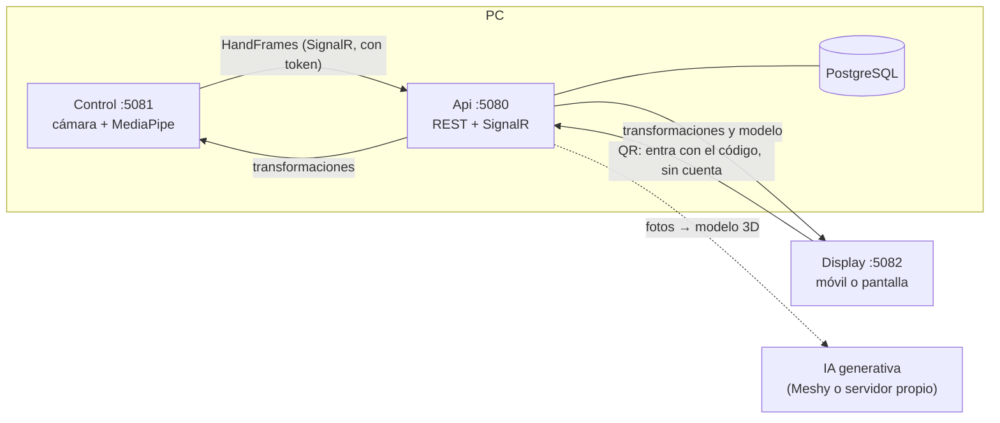

# Holograma3D

Control por gestos de un modelo 3D que se proyecta como holograma de 4 lados (pirámide tipo Pepper's ghost sobre un móvil) o en una pantalla plana. Para ensayar una demo completa, sigue [docs/DEMO.md](docs/DEMO.md).

| Control (PC con cámara) | Display: holograma de 4 lados | Display: vista plana |
|---|---|---|
|  |  |  |

| App | Qué hace | URL de desarrollo |
|-----|----------|-------------------|
| `Holograma3D.Api` | Núcleo hexagonal, REST y SignalR | http://localhost:5080 |
| `Holograma3D.Control` | PC con cámara: gestos, modelos y emparejamiento | http://localhost:5081 |
| `Holograma3D.Display` | Móvil o pantalla: proyección de 4 lados o plana | `http://<IP-LAN>:5082` |



Los gestos se interpretan en la Api (Core); el navegador solo envía los 21 puntos de cada mano.

## Estructura

```
src/Holograma3D.Core            Dominio, casos de uso y puertos (solo System.*)
src/Holograma3D.Infrastructure  Adaptadores de salida
src/Holograma3D.Api             Adaptadores de entrada y composición
src/Holograma3D.Control         Webapp de control (estáticos)
src/Holograma3D.Display         Webapp del proyector (estáticos)
tests/Holograma3D.Tests         xUnit
```

## Configuración personal

Toda la configuración sensible va en `.env` o en variables de entorno, nunca en `appsettings*.json` ni en git (`.env` está en `.gitignore`). No se usa user-secrets: así funciona igual en tu PC que en un servidor.

```powershell
Copy-Item .env.example .env
```

Las tres apps leen `.env` al arrancar: lo buscan en su carpeta de trabajo y hacia arriba (en desarrollo, la raíz del repo; en un servidor, junto a la app publicada). Si una clave existe también como variable de entorno real, gana la variable. Los tests y `dotnet ef` usan el mismo `.env`.

| Variable | Para qué | Por defecto |
|----------|----------|-------------|
| `ConnectionStrings__Holograma3D` | Cadena de PostgreSQL (obligatoria) | — |
| `GenerativeAi__Provider` | `Meshy`, `Http`, `Fake` o vacío (sin IA) | vacío |
| `GenerativeAi__ApiKey` | Clave del proveedor de IA (secreto) | — |
| `GenerativeAi__BaseUrl` | URL de tu servidor de IA (`Http`) u otra URL de Meshy | `https://api.meshy.ai` |
| `GenerativeAi__Model`, `__OutputFormat`, `__Texture`, `__MaxImages`, `__PollSeconds`, `__TimeoutMinutes`, `__TargetPolycount`, `__MaxActiveJobsPerUser` | Ajustes de la generación (ver `.env.example`) | `latest`, `glb`, `false`, 4, 5, 15, 30000, 3 |
| `PublicDisplayUrl` | URL del Display que va en el QR | `http://<IP LAN>:5082` |
| `Control__ApiBaseUrl`, `Display__ApiBaseUrl` | URL de la Api para cada cliente (túnel HTTPS) | mismo host, puerto 5080 |
| `Cors__Origins__0`, `__1`… | Orígenes permitidos fuera de Development | — |
| `Auth__AccessTokenMinutes` | Vida del token de acceso | 30 |
| `RateLimits__AuthPerMinute`, `RateLimits__AnonPerMinute` | Límite por IP de login/registro y de los endpoints anónimos | 10, 60 |
| `Reconstruction__ModelPath` | Ruta de `u2netp.onnx` | `models/u2netp.onnx` |
| `Storage__Root` | Carpeta de los archivos de los modelos | `storage` (junto a la Api) |

## Base de datos (PostgreSQL 18 local)

Una sola vez. Elige una contraseña para el rol de la app y úsala en los dos pasos; psql te pide la del superusuario `postgres`.

1. Crea el rol:

   ```powershell
   & "C:\Program Files\PostgreSQL\18\bin\psql.exe" -U postgres -h localhost -c "CREATE ROLE holograma3d LOGIN CREATEDB PASSWORD '<tu-contraseña>';"
   ```

2. En `.env`, completa `ConnectionStrings__Holograma3D=Host=localhost;Port=5432;Database=holograma3d;Username=holograma3d;Password=<tu-contraseña>`.

Los archivos de los modelos no van en la base: se guardan en `src/Holograma3D.Api/storage/models/` (ignorado por git; cambia la carpeta con `Storage__Root` en `.env`).

La Api aplica las migraciones al arrancar en Development. También puedes aplicarlas a mano:

```powershell
dotnet ef database update --project src/Holograma3D.Infrastructure --startup-project src/Holograma3D.Api
```

Para agregar una migración cuando cambie el modelo:

```powershell
dotnet ef migrations add <Nombre> --project src/Holograma3D.Infrastructure --startup-project src/Holograma3D.Api --output-dir Persistence/Migrations
```

## Cómo correr

```powershell
powershell -ExecutionPolicy Bypass -File .\run.ps1
```

`run.ps1` muestra la URL del Display para el móvil y abre una ventana por app. También puedes arrancar una sola (la Api lee el `.env` por su cuenta):

```powershell
dotnet run --project src/Holograma3D.Api
```

Pruebas (los tests de integración usan tu PostgreSQL local con la cadena del `.env`: cada corrida crea una base `holograma3d_test_*` y la borra al terminar):

```powershell
dotnet test Holograma3D.slnx
```

`src/Holograma3D.Api/Holograma3D.Api.http` trae las llamadas de autenticación y de modelos para probar a mano desde Visual Studio o VS Code (extensión REST Client).

## Control (PC con cámara)

Abre `http://localhost:5081` (la cámara solo funciona en localhost o HTTPS), crea tu cuenta o inicia sesión y permite la cámara. El Control:

- Crea o retoma tu sesión de holograma y muestra su código, el QR y la URL del proyector con botón Copiar.
- Reconoce las manos con MediaPipe en el navegador y envía los frames a la Api; arriba a la izquierda de la cámara verás fps, ms por inferencia y el RTT hasta el proyector.
- Administra tus modelos: arrastra un `.stl` o `.glb` (máx. 50 MB), "Proyectar", "Descargar", "Eliminar" o el modelo por defecto. Los modelos generados con IA o desde 5 fotos también se descargan desde su propia página.
- Muestra una vista previa con la misma transformación que el proyector. "Restablecer posición" (o la tecla R) devuelve el modelo al centro.

La sesión de usuario dura lo que la pestaña (sessionStorage); recargar no la cierra. MediaPipe, three.js y SignalR se cargan de CDN: el PC necesita internet.

## Configurar tu proveedor de IA

"Crear con IA" (en el Control) genera un modelo a partir de 1 a 4 fotos de un objeto. Cada persona elige su proveedor con variables de entorno; sin configurar, la página explica qué falta.

| Proveedor | Para qué | Variables mínimas |
|-----------|----------|-------------------|
| `Fake` | Probar el flujo sin red ni créditos: devuelve un octaedro | `GenerativeAi__Provider=Fake` |
| `Meshy` | [Meshy](https://www.meshy.ai) Multi-Image to 3D con tu cuenta | `GenerativeAi__Provider=Meshy`, `GenerativeAi__ApiKey` |
| `Http` | Tu propio servidor (TripoSR, Hunyuan3D-2…) con el [contrato documentado](docs/generative-http-contract.md) | `GenerativeAi__Provider=Http`, `GenerativeAi__BaseUrl` |

El resto (`Model`, `OutputFormat`, `MaxImages`, `PollSeconds`, `TimeoutMinutes`, `TargetPolycount`, `MaxActiveJobsPerUser`) está explicado en `.env.example`. Si la configuración no es válida (por ejemplo, Meshy sin clave), la Api no arranca y dice qué corregir.

En `.env`:

```
GenerativeAi__Provider=Meshy
GenerativeAi__ApiKey=<tu-clave>
```

En un servidor puedes definir las mismas claves como variables de entorno (systemd, Docker, IIS…); tienen prioridad sobre el `.env`. Para probar solo en la consola actual:

```powershell
$env:GenerativeAi__ApiKey = "<tu-clave>"
```

La clave nunca se escribe en logs ni se devuelve en respuestas, y solo viaja al host de Meshy (o de tu `BaseUrl`); la descarga del modelo terminado va a otro host sin la clave. Cada generación con Meshy consume créditos de tu cuenta.

## Crear desde 5 fotos (sin IA externa)

"Crear desde 5 fotos" (en el Control) arma un STL en el propio servidor, gratis: separa el objeto del fondo en 5 fotos (frontal, izquierda, derecha, trasera y superior), intersecta sus siluetas (volumen visual) y extrae la malla con Surface Nets. Funciona con objetos sin huecos (cajas, botellas, figuras); la base sale plana y las concavidades no se reconstruyen.

Para separar el objeto del fondo hay dos modos; la Api avisa al arrancar cuál usa:

- **Por umbral (por defecto):** no necesita nada más, pero pide fondo liso y contrastante.
- **U²-Netp:** funciona con fondos menos cuidados. Descarga `u2netp.onnx` (~4.7 MB) de los [releases del proyecto rembg](https://github.com/danielgatis/rembg/releases) o expórtalo desde los pesos oficiales de [U-2-Net](https://github.com/xuebinqin/U-2-Net) (licencia Apache-2.0; revísala antes de usarlo). Cópialo en `src/Holograma3D.Api/models/u2netp.onnx` (en un servidor, en `models/` junto a la Api publicada) o indica otra ruta con `Reconstruction__ModelPath` en `.env`, y reinicia la Api. Los `.onnx` están en `.gitignore`: no se suben al repositorio.

## Display (proyector)

Abre `http://<IP-LAN>:5082/?s=CODIGO` (lo hace el QR del Control), elige la vista y toca "Iniciar". Sin cuenta: entra con el código de la sesión.

- **Holograma 4 lados**: las 4 vistas en cruz para la pirámide sobre el móvil.
- **Plana**: una sola vista de frente a pantalla completa, para proyectar en una pared, una TV o un proyector. Responde a los mismos gestos.

La vista elegida se guarda en el navegador. Para cambiarla en marcha, toca la pantalla: aparece unos segundos el botón "Ver plana" / "Ver holograma".

| Parámetro | Para qué |
|-----------|----------|
| `?s=CODIGO` | Código de la sesión; sin él, el Display lo pide |
| `?demo=1` | Sin Api: gira el modelo por defecto, para probar la pirámide |
| `?calib=1` | Abre la calibración (también con tres toques rápidos) |
| `?hud=1` | Muestra la conexión, el gesto y los fps en una esquina |

En marcha, un toque largo vuelve a la pantalla inicial. En la calibración, el "Cubo de prueba" ayuda a orientar la pirámide: desde el lado sur debe verse la cara roja de frente y la verde a la derecha. Los valores se guardan en el navegador del móvil.

## Móvil en la misma red

El móvil entra a la Api (5080) y al Display (5082) por la IP LAN del PC. Si no conecta, abre esos puertos en el firewall de Windows desde una consola de administrador:

```powershell
New-NetFirewallRule -DisplayName "Holograma3D (5080, 5082)" -Direction Inbound -Protocol TCP -LocalPort 5080,5082 -Action Allow -Profile Private
```

El QR de cada sesión apunta al Display en la IP LAN que detecta la Api (la imprime al arrancar: "El QR de las sesiones apunta a…"). Si detecta otra interfaz, fija la URL con `PublicDisplayUrl` en `.env`. Para HTTPS en el móvil (pantalla encendida y completa fiables), usa un túnel: ver [docs/DEMO.md](docs/DEMO.md#https-para-el-móvil-con-dev-tunnels).

Los valores de calibración de gestos están en la sección `Gestures` de `src/Holograma3D.Api/appsettings.json` y se leen al arrancar la Api; cómo ajustarlos, en [docs/DEMO.md](docs/DEMO.md#calibrar-los-gestos).

## Plantilla de la pirámide

Corta 4 trapecios iguales en acetato o PET transparente (una carpeta o la tapa de un empaque sirven) y únelos por los lados con cinta transparente, con la base menor abajo:

| Para | Base menor | Base mayor | Altura |
|------|-----------|-----------|--------|
| Móvil | 1 cm | 6 cm | 3.5 cm |
| Tablet | 2 cm | 12 cm | 7 cm |

[docs/piramide.svg](docs/piramide.svg) trae los 4 trapecios del móvil a escala real: imprímela al 100 % (o al 200 % para tablet) y calca sobre el acetato. Coloca la pirámide con la base menor en el centro de la cruz del Display, en un cuarto oscuro y con el brillo al máximo.

## Solución de problemas

| Síntoma | Causa probable y solución |
|---------|---------------------------|
| La Api no arranca: "Falta la cadena de conexión" o error de conexión | PostgreSQL apagado (`Get-Service postgresql-x64-18`, luego `Start-Service postgresql-x64-18`) o `ConnectionStrings__Holograma3D` vacía en `.env`. |
| La Api no arranca por `GenerativeAi` | La configuración de IA no es válida (por ejemplo, Meshy sin clave); el error dice qué falta. |
| Los tests de integración fallan al empezar | Igual que arriba: PostgreSQL apagado o sin cadena en `.env` (los tests no usan Docker). |
| "Permiso de cámara denegado" en el Control | Permite la cámara en el candado de la barra de direcciones; ábrelo en `http://localhost:5081` (no con la IP); cierra Teams/Zoom si la ocupan. |
| El móvil no abre el Display o no conecta | Firewall (regla de arriba), otra Wi-Fi o IP equivocada en el QR (`PublicDisplayUrl`). |
| El holograma se ve al revés o en espejo | En la calibración del Display (tres toques): interruptores "Espejo" y "Arriba hacia dentro"; verifica con el cubo de prueba. |
| La imagen se ve tenue | Brillo del móvil al máximo, cuarto oscuro y pirámide limpia. |
| "Crear con IA" responde 503 | Proveedor sin configurar: `GenerativeAi__Provider` (y la clave) en `.env`, luego reinicia la Api. |
| "Crear desde 5 fotos" no detecta el objeto | Fondo más liso y contrastante, o instala `u2netp.onnx` (sección de arriba). |
| El Display se queda con el modelo anterior | La descarga falló (404): el modelo se borró; proyecta otro desde el Control. |
